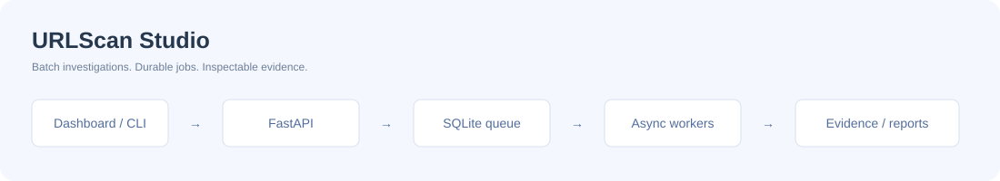

# URLScan Studio

A URL investigation workbench: **FastAPI + asyncio + a durable SQLite queue**, with a CLI, browser dashboard and a self-contained interactive demo. Version 2 replaces the original sequential CSV script while keeping the `python urlscan.py urls.txt` entry point.



## Public Vercel edition (2.1)

The root `app.py` exports the stateless cloud application. Deploy this repository as a FastAPI project on Vercel, or run `python -m uvicorn app:app --port 4181` locally.

Paste new URLs directly into the **Paste new links to inspect** field on the home screen. **Scan links** returns live HTTP status, redirects, a bounded HTML read, response headers, baseline checks and actionable recommendations. **Run live test** checks python.org; **Run sample test** calls the backend with explicitly synthetic fixtures. The UI inspector separates findings, domains, HTTP navigation, headers and screenshots.

Live HTTP inspection supports up to five public URLs, two concurrent checks, five redirects, a 512 KiB body limit, 20 seconds per check and a 24-second batch deadline. DNS answers are checked and connections are pinned to validated public IPs. Only web ports 80/443 are accepted. The baseline score is a limited HTTP checklist, not a vulnerability or malware verdict. HTML resource references are listed but not fetched. No JavaScript executes in the HTTP inspection process.

**Screenshots** are optional and requested separately after HTTP results return. Public target URLs are sent to Microlink, with a matching dated public urlscan.io archive image as fallback. Microlink images may be cached and do not supply a capture time; the UI says so. Archived images retain their original scan date. Quota/provider failures leave HTTP results intact, never substitute a fake screenshot, and are shown in the page-preview card. The unauthenticated Microlink endpoint has a small daily quota; set your own `MICROLINK_API_KEY` in Vercel if you need its authenticated allowance. Provider limits are documented at <https://microlink.io/docs/api/basics/rate-limit>.

The cloud deployment has no SQLite database or detached daemon. Its last 10 runs are stored in the current browser; JSON/CSV exports retain provenance. Local cancellation stops waiting in the UI; it cannot undo already-started HTTP or screenshot provider requests. There is no authentication or shared server-side history in this public edition.

Vercel entrypoint: `app.py`; configuration: `vercel.json`; Python: `.python-version`. The original local durable-worker edition remains available below.

## Try the local durable-worker edition

Python 3.11 or newer:

```sh
python -m venv .venv
# Windows: .venv\Scripts\activate
# macOS/Linux: source .venv/bin/activate
python -m pip install -e '.[dev]'
python -m urlscan_studio.cli serve
```

Open **http://127.0.0.1:4180** and select **Run sample batch**. Explore a result, switch between findings/domains/requests, filter the batch, inspect history, and export CSV or JSON. API documentation: **http://127.0.0.1:4180/docs**.

The default provider is `demo`: fictional `.test` domains and documentation IPs, no API key, and no requests to scanned websites or urlscan.io. The dashboard served by Python submits real background jobs and persists their synthetic results. One sample intentionally fails to demonstrate partial failure handling.

### Static interactive demo

Serve `urlscan_studio/web/` with any static HTTP server. It uses the same UI and fixtures, with an explicitly labeled **browser simulation** in place of the backend. It supports batch input, deduplication, progress, filters, evidence inspection, cancellation, session history and downloads. Static history and demo cache exist only for the current page session. It does not perform real scans, contact targets, use an API key or claim server persistence.

## What changed from v1

| Original script | Studio |
| --- | --- |
| One URL at a time, fixed 40-second wait | Bounded async concurrency, pending-result polling and explicit deadlines |
| Embedded API key | Key read only from `URLSCAN_API_KEY` |
| Public submissions | Explicit visibility, private by default |
| Assertions and missing-field failures | Typed request validation, per-item errors and unknown verdicts |
| CSV only | Dashboard, JSON/CSV exports, history, OpenAPI and CLI |
| Work lost on interruption | SQLite jobs/events/results and saved provider scan IDs |
| Repeated requests | Normalized deduplication, idempotent batch submission and scoped cache |

No flags means **no flags in the observed provider verdict**, not a guarantee that a site is safe. Unknown and failed scans are never counted as clean. Third-party evidence uses a different-hostname comparison; it does not establish who owns a domain. TLS validity is the certificate validity period reported by the provider, not days remaining.

## Architecture

```text
Browser / CLI
    │ validated batch + optional idempotency key
    ▼
FastAPI → SQLite jobs / items / events
                    │ durable FIFO queue
                    ▼
             One worker process
             asyncio.Semaphore (1–8 slots)
                    │
             provider adapter
              ├── Demo fixtures (no network)
              └── urlscan.io submit → persist UUID → bounded poll → normalize
                    │
             results + scoped cache → inspector / JSON / CSV
```

- Each SQLite operation uses its own short transaction; WAL and a busy timeout handle dashboard reads while work runs. Jobs are claimed in an immediate transaction.
- Startup recovers interrupted work for the configured provider. Persisted scan UUIDs resume result polling without another submission. There remains an unavoidable gap if the provider accepts a POST but the connection fails before returning its UUID; ambiguous POST failures are not automatically retried.
- HTTP 429 and GET failures have bounded retries; quota waits respect numeric `Retry-After` / reset-after values. Waits above one minute are returned as actionable failures rather than silently ignoring the quota.
- Cancellation stops in-flight local coroutines and preserves completed items. It cannot undo a scan already accepted by urlscan.io. Retrying a finished batch processes failed items only and reuses saved scan IDs.
- Cache keys include normalized URL, provider and visibility. Cache hits do not refresh the original observation's TTL. HTTP fragments, query strings and case-sensitive paths are preserved.
- Up to 100 URLs per batch, 20 pending batches, 50 recent history summaries and 100 recent events per job response. The database is not automatically pruned.

This is a **single-user, single-process local service**, not a distributed queue or multi-tenant SaaS. Use one ASGI worker and one server process per database. The CLI uses a separate database by default. Add authentication, per-user data isolation and an external worker queue before an Internet-facing deployment. Host and write-origin checks reduce exposure to unsolicited local-browser requests; they are not user authentication.

## Live provider

Use your own urlscan.io API key. On PowerShell:

```powershell
$env:URLSCAN_PROVIDER = 'urlscan'
$env:URLSCAN_API_KEY = '<your-own-key>'
$env:URLSCAN_DATABASE = 'live-studio.db'
python -m urlscan_studio.cli serve
```

On POSIX shells, use `export URLSCAN_PROVIDER=urlscan` and `export URLSCAN_API_KEY=...` instead. `.env.example` documents variables; `.env` is **not loaded automatically**. Restart the process after configuration changes. Do not paste keys into the UI, commit them, or use shared databases across provider accounts.

The UI makes visibility explicit. **Private** scans require your provider account's quota. **Unlisted** scans are visible to vetted Pro users; **public** scans are publicly searchable. URLs are submitted to the third-party provider; remove tokens or personal data before scanning. The server connects only to the provider API and does not fetch arbitrary targets, screenshots or DOM files itself.

The key present in the original repository's history must be rotated by its owner. Removing it from the current source does not erase Git history.

Provider behavior follows [urlscan.io API documentation](https://urlscan.io/docs/api/) and [result reference](https://urlscan.io/docs/result/). A live credentialed scan is not required for tests; HTTP behavior is verified against a mocked transport.

## CLI

```sh
python -m urlscan_studio.cli scan urls.txt --name 'Launch audit'
python -m urlscan_studio.cli scan urls.txt --format csv --output output/report.csv
python -m urlscan_studio.cli scan targets.txt --provider urlscan --visibility private
python urlscan.py urls.txt
```

Blank lines and `#` comments are ignored. Default output is `output/investigation.json`; `--format csv` changes the default extension. Exit status: `0` all items completed, `2` some failed, `1` input/configuration error. The sample batch exits `2` intentionally because `offline.test` exercises a failure. The CLI database defaults to `cli-studio.db`; do not point it at an active server database.

## API examples

```sh
curl -X POST http://127.0.0.1:4180/api/jobs \
  -H 'Content-Type: application/json' -H 'Idempotency-Key: launch-audit-1' \
  -d '{"name":"Launch audit","urls":["https://atlas.test/"],"visibility":"private"}'
curl http://127.0.0.1:4180/api/jobs/JOB_ID
curl -X POST http://127.0.0.1:4180/api/jobs/JOB_ID/cancel
curl -X POST http://127.0.0.1:4180/api/jobs/JOB_ID/retry
curl 'http://127.0.0.1:4180/api/jobs/JOB_ID/export?format=json'
```

Submission returns `202`. Reusing an idempotency key with the same normalized request returns the existing job; reusing it with a different request returns `409`. Validation errors return `422`, and a full queue returns `429`. Failed URLs are recorded on their items; successful neighbors remain available.

## Tests

```sh
python -m pytest -q
```

Tests cover URL normalization, invalid/local inputs, atomic idempotency conflicts, queue capacity, restart recovery, provider isolation, cancellation races, bounded concurrency, partial failures, scoped cache, pending results, quota backoff, ambiguous POST failures, redirect boundaries, missing metadata, API history/exports and local origin guards. CI runs on Python 3.11–3.13.

## Container

```sh
docker build -t urlscan-studio .
docker run --rm -p 127.0.0.1:4180:4180 -v urlscan-data:/data urlscan-studio
```

The container runs as an unprivileged user. The example publishes only to loopback. Docker packaging is supplied separately from the directly tested local Python workflow.
